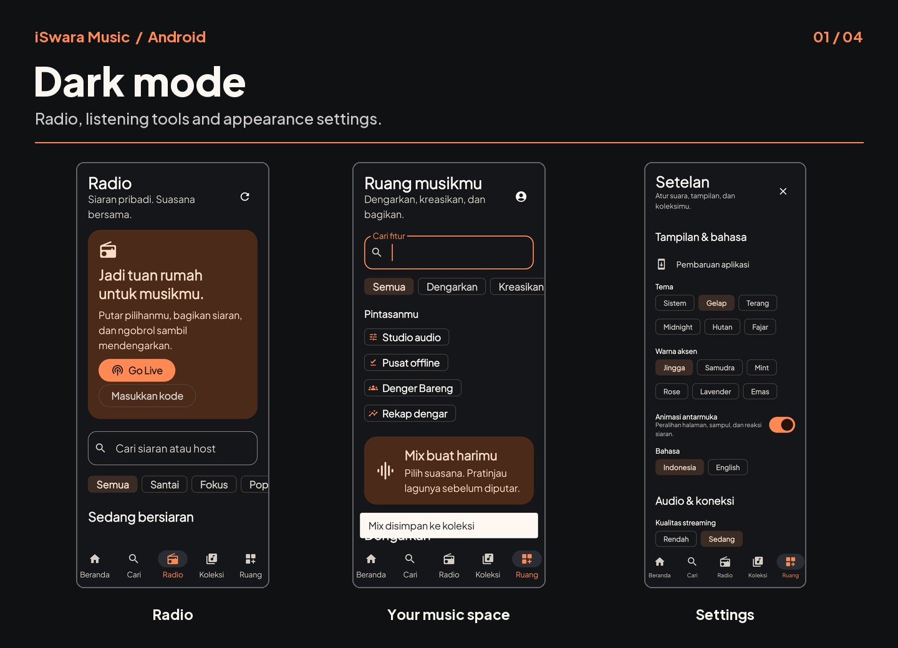
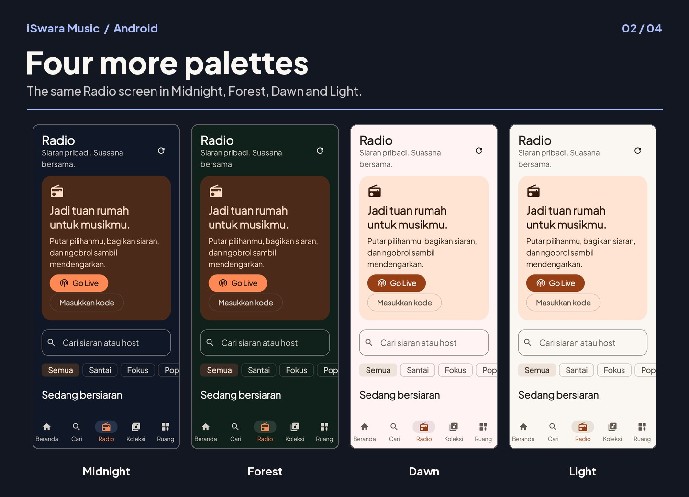
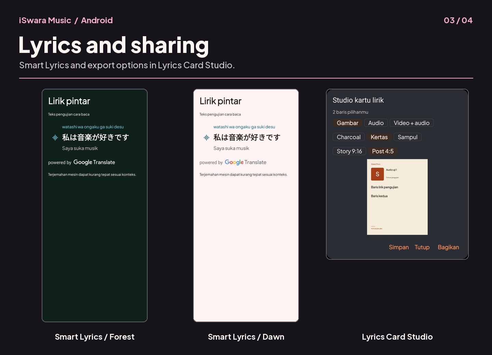
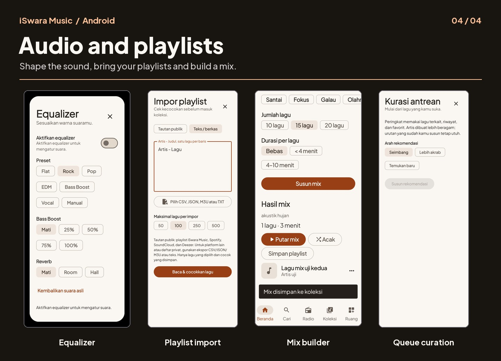

# iSwara Music 0.9.1 screenshots

These panels use screenshots from earlier iSwara app tests. Some screens contain test data.

## Dark mode

[Radio](../../screenshots/radio-dark-phone.png) ? [Your music space](../../screenshots/space-dark-phone.png) ? [Settings](../../screenshots/settings-dark.png)

## Four more palettes

[Midnight](../../screenshots/radio-midnight-phone.png) ? [Forest](../../screenshots/radio-forest-phone.png) ? [Dawn](../../screenshots/radio-dawn-phone.png) ? [Light](../../screenshots/radio-light-phone.png)

## Lyrics and sharing

[Smart Lyrics / Forest](../../screenshots/smart-lyrics-forest.png) ? [Smart Lyrics / Dawn](../../screenshots/smart-lyrics-dawn.png) ? [Lyrics Card Studio](../../screenshots/lyrics-card-studio.png)

## Audio and playlists

[Equalizer](../../screenshots/equalizer.png) ? [Playlist import](../../screenshots/import-0.9-phone.png) ? [Mix builder](../../screenshots/mix-preview-phone.png) ? [Queue curation](../../screenshots/curation-0.9-phone.png)
